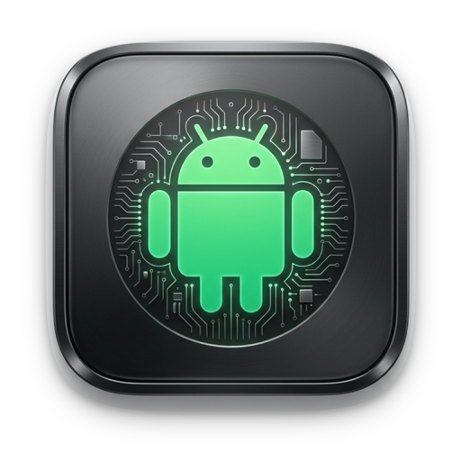
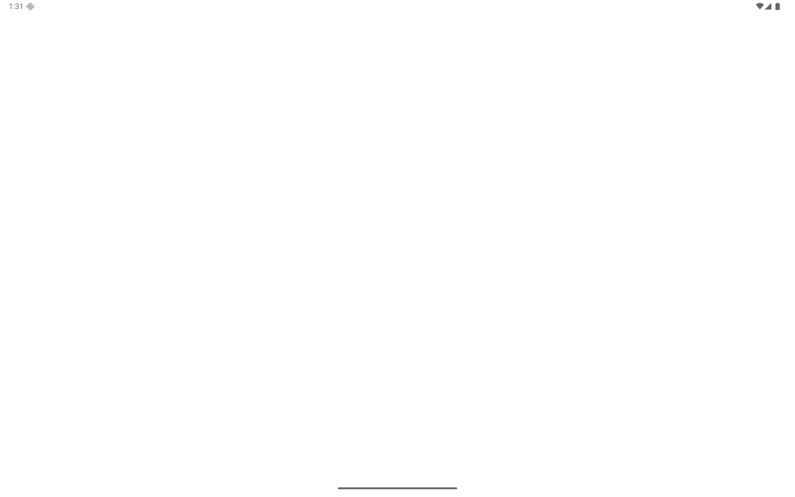

<p align="center">
  
</p>

<h1 align="center">AndroMac 🍏📱</h1>

<p align="center">
  <b>High-Performance Native Android 16 Tablet Environment & Launcher for Apple Silicon Macs</b>
</p>

<p align="center">
  <a href="https://swift.org"></a>
  <a href="https://apple.com"></a>
  <a href="https://apple.com"></a>
  <a href="https://developer.android.com"></a>
  <a href="LICENSE"></a>
  <a href="https://github.com/sabbirmohammad/AndroMac/actions"></a>
</p>

<p align="center">
  <b>English Documentation</b> | <a href="README_BN.md">বাংলা সংস্করণ (Bengali Version)</a>
</p>

---

## 📖 Overview

**AndroMac** is an open-source, ultra-fast, native macOS desktop launcher and tablet virtualization orchestrator engineered specifically for **Apple Silicon Macs** (M1, M2, M3, M4, and newer).

Unlike web-based mockups or phone-framed wrappers, AndroMac directly leverages Apple's **Hypervisor.framework (HVF)**, Metal-accelerated host GPU rendering, and official Google ARM64 system images to deliver an uncompromising, **2560 × 1600 (16:10)** landscape Android tablet experience.

<p align="center">
  
</p>

---

## ✨ Key Features

- 🖥️ **Native 16:10 Aspect Ratio**: Tailored specifically for MacBook and Apple display geometry (**2560 × 1600 @ 280 DPI**) with genuine Android Tablet UI (dual-pane notification shade, tablet taskbar, split-screen multitasking).
- 📺 **In-App Interactive Live View**: View and control the Android tablet directly inside the launcher window via interactive mouse click (Tap) and drag (Swipe) streaming.
- 🔲 **Zero-Bezel Frameless Display**: Eliminates all synthetic mobile phone skins (`showDeviceFrame=no`) for maximum usable screen real estate.
- 🛍️ **Pre-Configured Google Play Store**: Powered by official ARM64 system images with genuine Google Play Store and Google Play Services (`com.android.vending`) ready out-of-the-box.
- 📋 **Bidirectional Clipboard Sync**: Seamlessly sync copied text between macOS and Android clipboard in real time.
- 📁 **Instant File & Media Sharing**: Drag & drop photos, documents, music, and APKs straight into `/sdcard/Download` with instant media scanner broadcast indexing.
- 🎮 **Game Keymapper & Gamepad Support**: Built-in keyboard keymapper (WASD, Space, action keys) and native Bluetooth controller pass-through (PS5 DualSense / Xbox Wireless) via Apple `GameController.framework`.
- ⚡ **Instant Snapshots & State Recovery**: Save and restore the emulator's full RAM state in under 2 seconds.
- 🗂️ **Multi-Instance Profile Manager**: Create, isolate, clone, and switch between customized device configurations (Gaming, Work, Social).
- 📦 **One-Click APK Installer**: Validate and install local `.apk` packages via an intuitive drag-and-drop interface with ADB diagnostic feedback.
- 🔄 **In-App OTA Updates**: Automated release checker alerting you whenever a new release is published.
- 💾 **Full Data Persistence**: User data, Google account logins, downloaded apps, and settings persist safely across reboots.

---

## 🏗️ System Architecture

```
+-----------------------------------------------------------------------------------------+
|                                  AndroMac.app (macOS)                                   |
|                         (Swift 6 / SwiftUI Native Application)                          |
+-----------------------------------------------------------------------------------------+
| Live View | File Share | APK Mgr | Controls | Keymapper | Snapshots | Instances | Logs  |
+-----------+------------+---------+----------+-----------+-----------+-----------+-------+
      |           |           |         |          |           |           |         |
      v           v           v         v          v           v           v         v
+-----------------------------------------------------------------------------------------+
|                                    AndroMac Services                                    |
|  - ClipboardSyncService (Seamless Bidirectional Background Sync)                        |
|  - FileTransferService (Drag & Drop, Media Scanner Broadcast, /sdcard/Download)         |
|  - GameKeymapperService (Apple GameController.framework, PS5/Xbox, WASD Touch Mapper)   |
|  - SnapshotService (Instant QEMU RAM State Save, Load & Delete Subsystem)               |
|  - InstanceManager (Multi-AVD Discovery, Spec Parsing, Creation, Cloning)               |
|  - UpdateCheckerService (GitHub Releases & Version Compatibility)                       |
|  - EnvironmentDetector (Architecture & SDK Discovery)                                   |
|  - AVDManager (16:10 Tablet AVD Profile & Hardware Config)                              |
|  - EmulatorProcessManager (Async QEMU Hypervisor Lifecycle)                             |
|  - ADBService (Input, Screencap, Keyevents, Package Mgr)                                |
|  - APKInstallerService (Validation & Error Code Diagnosis)                              |
|  - FullScreenCoordinator (macOS Window & Full-Screen Host)                              |
+-----------------------------------------------------------------------------------------+
                                             |
                                             v
+-----------------------------------------------------------------------------------------+
|                          Official Android Emulator (Apple Silicon)                      |
|                        qemu-system-aarch64 via Hypervisor.framework                     |
|                          - Metal GPU Acceleration (host)                                |
|                          - Hardware Keycode Forwarding                                  |
+-----------------------------------------------------------------------------------------+
                                             |
                                             v
+-----------------------------------------------------------------------------------------+
|                     Android 16 ARM64 Guest OS (Google Play Edition)                     |
|  - Resolution: 2560x1600 @ 280 DPI (Landscape Tablet)                                    |
|  - Framework: Android Taskbar, Quick Settings, Settings UI                              |
|  - Google Play Services & Play Store                                                    |
+-----------------------------------------------------------------------------------------+
```

---

## 🖥️ System Requirements

| Requirement | Minimum Specification | Recommended Specification |
| :--- | :--- | :--- |
| **Processor** | Apple Silicon M1 (ARM64) | Apple Silicon M2 / M3 / M4 (Pro / Max) |
| **macOS Version** | macOS 13.0 Ventura | macOS 14 Sonoma or macOS 15 Sequoia |
| **Unified Memory** | 8 GB (3 GB allocated to guest) | 16 GB+ Unified Memory |
| **Storage** | 10 GB free SSD space | 25 GB+ free SSD space |
| **Prerequisites** | Android SDK (`emulator`, `platform-tools`) | Installed via Android Studio or Command Line Tools |

---

## 🚀 Getting Started

### Option 1: Download Pre-Built DMG (Recommended)

1. Navigate to [Releases](https://github.com/sabbirmohammad/AndroMac/releases).
2. Download the latest `AndroMac-x.x.x-AppleSilicon.dmg`.
3. Open the `.dmg` file and drag **AndroMac** into your `/Applications` folder.
4. Launch **AndroMac** from Launchpad or Spotlight.

### Option 2: Build From Source

```bash
# 1. Clone the repository
git clone https://github.com/sabbirmohammad/AndroMac.git
cd AndroMac

# 2. Compile release binary
swift build -c release

# 3. Assemble macOS .app bundle
./scripts/build_app.sh

# 4. (Optional) Generate standalone .dmg installer
./scripts/create_dmg.sh
```

---

## 🕹️ Feature Guide & Walkthrough

### 1. Interactive Live View
- Navigate to the **Dashboard** and toggle **Live In-App Stream**.
- Interact with Android directly using your mouse: click to tap, drag to swipe.
- Use the direct navigation bar at the bottom for quick access to **Back**, **Home**, **Recents**, **Volume Up/Down**, and **Display Rotation**.

### 2. Bidirectional Clipboard Synchronization
- Open the **Controls & Gestures** tab.
- **Auto-Sync** is enabled by default. Text copied on macOS is instantly injected into Android's clipboard, and text copied within Android is mirrored to macOS.

### 3. File & Media Sharing
- Open the **File Sharing** tab.
- Drag any file (photo, video, PDF, audio) into the drop target.
- Files are saved to `/sdcard/Download` and indexed via Android's `android.intent.action.MEDIA_SCANNER_SCAN_FILE` broadcast.
- To export files from Android to macOS, select the item and click **Save to Mac**.

### 4. Game Keymapping & Gamepad
- Open the **Game Keymapper** tab and enable the keymapper.
- Select from preset configurations (WASD + Space + Attack) or configure custom coordinate mappings.
- Connect a Bluetooth controller (DualSense, Xbox Wireless) to pass inputs through natively.

### 5. Snapshot & Instant Recovery
- Open the **Snapshots & Backup** tab.
- Click **Take Snapshot Now** to freeze RAM state.
- Restore within ~2 seconds at any point without needing a full cold reboot.

### 6. Multi-Instance Management
- Open the **Instance Manager** tab to provision distinct AVD instances with different memory and display presets.
- Clone or switch between profiles in a single click.

---

## 🧪 Testing

To run the automated integration test suite locally on your Mac:

```bash
./scripts/test_suite.sh
```

---

## 🛡️ Security & Privacy

- **100% Official Google Binaries**: Uses only official, signed Google Android emulator binaries and system images. No third-party ROMs, cracked binaries, or untrusted APKs are bundled.
- **Local Sandbox**: Google credentials and personal logins remain isolated inside Android's native encrypted sandbox. No data is harvested or transmitted externally.
- **Resource Management**: When closed, `adb emu kill` cleanly terminates all emulator processes, preventing CPU or battery drain in the background.

---

## 🤝 Contributing

Contributions, bug reports, and suggestions are warmly welcomed! Please read our [Contributing Guidelines](CONTRIBUTING.md) and [Code of Conduct](CODE_OF_CONDUCT.md) before opening a pull request.

---

## 📄 License

This project is licensed under the **MIT License**. See the [LICENSE](LICENSE) file for details.

---

<p align="center">
  Made with ❤️ for the macOS and Android developer community.
</p>
